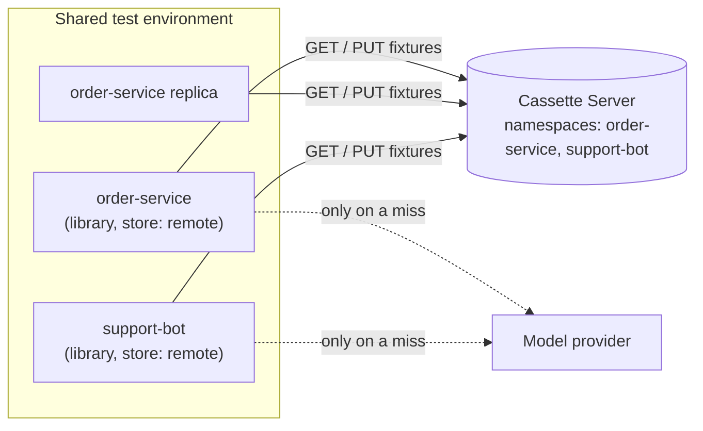

# Cassette Server

[](https://github.com/rifatcakir/spring-ai-test-tools-server/actions/workflows/ci.yml)
[](https://github.com/rifatcakir/spring-ai-test-tools-server/releases)
[](LICENSE)

**One shared store of recorded AI answers for a whole test environment.**

[spring-ai-test-tools](https://github.com/rifatcakir/spring-ai-test-tools) records a Spring AI
application's model calls once and replays them afterwards: deterministic tests, no tokens, no
model needed. By default the recordings ("fixtures") are files in the project's
`src/test/resources`. That works for a laptop and for CI. It does not work for an application
running in a **shared test, QA or demo environment**, which has no checked-out sources, may run
as several instances, and whose recordings nobody can see.

The Cassette Server is where those fixtures live instead. Applications keep doing all the work
(hashing, recording, replaying, tool isolation, redaction); the server only stores the fixtures,
for every application in the environment, by namespace.



The server **never calls a model provider** and holds no provider key. On a miss, the
application calls its model as it always would and stores the result on the server; from then
on every instance gets that answer from the server, with no model call.

| | File store (default) | Remote store + Cassette Server |
|---|---|---|
| Where fixtures live | `src/test/resources/llm-cache*` | The server, per namespace |
| Who records and replays | The application | **The same application**, unchanged |
| Fixture format and hash | | **Identical**, byte for byte |
| Chat, streaming, tools, embeddings | yes | **yes** |
| Turned on by | `spring.ai.test.vcr.enabled: true` | plus `store: remote`, a URL and a namespace |
| Typical use | unit tests, CI | deployed test environments, several services or replicas, e2e, QA, demos |

## Quick start

**1. Run the server.** Java 21 is the only requirement; Docker is optional.

```bash
curl -LO https://github.com/rifatcakir/spring-ai-test-tools-server/releases/download/v0.2.0/spring-ai-test-tools-server-0.2.0.jar
java -jar spring-ai-test-tools-server-0.2.0.jar --admin-token=change-me
```

or

```bash
docker run -p 9090:9090 -v cassettes:/data/cassettes \
  -e CASSETTE_ADMIN_TOKEN=change-me ghcr.io/rifatcakir/spring-ai-test-tools-server:0.2.0
```

**2. Point an application at it.** The application needs
`io.github.rifatcakir:spring-ai-test-tools:0.2.0` on its classpath, and this configuration. No
code changes:

```yaml
spring:
  ai:
    test:
      vcr:
        enabled: true
        store: remote
        remote:
          url: http://localhost:9090
          namespace: order-service
```

**3. Use it.** The first call to a prompt goes to the model and is stored on the server; every
later call, from any instance using that namespace, is replayed from the server.

```bash
curl -H "Authorization: Bearer change-me" http://localhost:9090/__admin/namespaces/order-service/fixtures
```

A five-minute walkthrough with no API key and no model to install:
[`examples/cassette-server-demo`](examples/cassette-server-demo/README.md).

## What you get

- **Shared recordings.** Replicas and services that use the same namespace share one set of
  fixtures. Two instances that miss on the same prompt at once record it once: the server keeps
  the first and tells the second.
- **Mode control without redeploys.** An application that sets no mode follows its namespace's
  default, which an admin changes at runtime: `RECORD_ALWAYS` to re-record an environment for an
  afternoon, `REPLAY_ONLY` to seal it again. A mode set in the application always wins.
- **Loud failures.** If the server is unreachable, the call fails. The application never quietly
  calls the model instead, and never quietly falls back to local files.
- **Reviewable recordings.** Export a namespace as a zip in exactly the `src/test/resources`
  layout, unzip, commit, and review the fixtures in a pull request like any other change.
- **Visibility.** List, inspect and delete fixtures, and see which lookups recently missed, over
  a small admin API.

## Documentation

| | |
|---|---|
| [Getting started](docs/getting-started.md) | Install, connect an application, record and replay, seed and export a namespace |
| [How it works](docs/how-it-works.md) | Request flow, namespaces, modes, storage, concurrency, what the server checks |
| [Configuration](docs/configuration.md) | Every server flag and environment variable, and the application-side properties |
| [API reference](docs/api.md) | Every endpoint, with real requests and responses |
| [Operations](docs/operations.md) | Docker Compose, Kubernetes, health checks, backups, security, upgrades |
| [Troubleshooting](docs/troubleshooting.md) | Each error message, what causes it, and the fix |

Versioning: use the **same server version as the library** (server 0.2.0 with library 0.2.0).
See the [CHANGELOG](CHANGELOG.md).

## This repository

| Directory | What |
|---|---|
| [`spring-ai-test-tools-server/`](spring-ai-test-tools-server) | The server: a Spring Boot executable jar and its [`Dockerfile`](spring-ai-test-tools-server/Dockerfile). No Spring AI dependency |
| [`spring-ai-test-tools-it/`](spring-ai-test-tools-it) | End-to-end tests: the server image, the published library with `store: remote`, a real Ollama model |
| [`examples/cassette-server-demo/`](examples/cassette-server-demo) | A runnable walkthrough |
| [`examples/docker-compose/`](examples/docker-compose) | A Compose file for a shared environment |
| [`fixture-contract/`](fixture-contract) | Fixtures written by the library, which the server must accept byte for byte |

```bash
mvn test                          # server tests
mvn -Pintegration-test verify     # plus end to end (Docker; the library comes from Maven Central)
```

More end-to-end scenarios, from an application's point of view, are in
[spring-ai-test-tools-example](https://github.com/rifatcakir/spring-ai-test-tools-example)
(`CassetteServerRemoteStoreTest`, `CassetteServerSharedEnvironmentTest`).

The client side (the remote store, hashing, record/replay) is the library,
[rifatcakir/spring-ai-test-tools](https://github.com/rifatcakir/spring-ai-test-tools). The
design notes are its [`docs/SERVER-PRD.md`](https://github.com/rifatcakir/spring-ai-test-tools/blob/main/docs/SERVER-PRD.md).

> **Internal test networks only.** Fixtures contain prompts and answers. Do not expose this server
> to the internet. Redaction happens in the application before anything is sent; see
> [Operations: security](docs/operations.md#security).

Apache-2.0.
