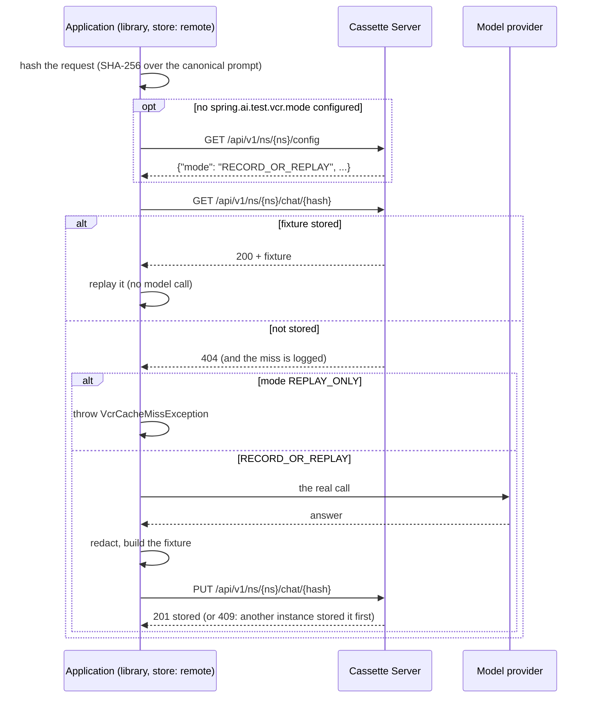

# How it works

The short version: **the application decides, the server stores.** Everything that needs Spring
AI (computing the fixture's hash, deciding hit or miss, calling the model, isolating tools,
redacting) happens in the application, in the
[spring-ai-test-tools](https://github.com/rifatcakir/spring-ai-test-tools) library. The server
keeps JSON documents by namespace, kind and hash, and a default mode per namespace. It has no
Spring AI dependency and never talks to a model provider.

## One call, step by step



`RECORD_ALWAYS` skips the lookup, calls the model and stores with `PUT ...?overwrite=true`.
`BYPASS` touches neither the server nor fixtures.

If any request to the server fails (connection refused, timeout, `5xx`, a refused token), the
call fails with `CassetteServerException`. It is never treated as a miss: a miss can mean "call
the model", and an environment that silently starts calling the model whenever the server blips
is exactly what this exists to prevent. There is no fallback to local files either.

## Fixtures and kinds

A fixture is one recorded exchange, as one JSON document. There are four kinds, matching the
library's four kinds of calls:

| Kind | What it records | Directory on the server |
|---|---|---|
| `chat` | A `ChatClient...call()` | `llm-cache/` |
| `stream` | A `ChatClient...stream()`, chunk by chunk | `llm-cache/` |
| `embedding` | An `EmbeddingModel` call | `llm-cache-embedding/` |
| `tool` | One tool execution, so the real `@Tool` doesn't run on replay | `llm-cache-tool/` |

Chat and stream fixtures share a directory because the library's file store does the same; their
hashes can never collide (they are computed over different canonical forms).

The fixture's name is the SHA-256 of the exact request: messages, model options, tool definitions,
structured-output schema. There is no similarity matching of any kind. A prompt that changed by one
character is a different fixture, which is what makes a replay trustworthy.

## Namespaces

A namespace is a separate set of fixtures, usually one per application (`order-service`,
`support-bot`). Replicas of one application use the same namespace and so share recordings. Two
different applications can share a namespace on purpose, if they send the same prompts and should
get the same answers.

Namespace names are letters, digits, `.`, `_` and `-`, starting with a letter or digit, up to 128
characters. A namespace exists as soon as something is stored in it or a mode is set for it.

## Modes

The library has four modes:

| Mode | Lookup | On a miss |
|---|---|---|
| `RECORD_OR_REPLAY` | yes | call the model and store the answer |
| `REPLAY_ONLY` | yes | fail with `VcrCacheMissException`; the model is never called |
| `RECORD_ALWAYS` | no | always call the model, replace the stored answer |
| `BYPASS` | no | always call the model, store nothing |

**The application decides.** If the application sets `spring.ai.test.vcr.mode`, that mode is used,
always, in either direction, and the server is never asked. If it sets none, it asks the server on
every call (`GET /api/v1/ns/{ns}/config`) and uses the namespace's default:

1. the mode an admin set for the namespace (`PUT /__admin/namespaces/{ns}/mode`), else
2. the server-wide default (`--default-mode`, `RECORD_OR_REPLAY` unless changed).

Because it is asked on every call, an admin's change applies to the very next call, with no
restart. A team that pinned `REPLAY_ONLY` in its own configuration on purpose is never overridden.
Namespace modes are saved to disk and survive a restart.

## Concurrency: two instances, one prompt

Two instances that miss on the same prompt at the same moment both call the model (neither knew
the other was about to). The first `PUT` stores its fixture (`201`); the second gets `409 Conflict`
with the stored document, discards its own, and logs that it did. From then on everyone replays the
first recording. Only `RECORD_ALWAYS` replaces an existing fixture.

Writes to the same fixture are serialized inside the server, and each write goes to a temporary
file that is then moved into place, so a crash can never leave a half-written fixture behind.

## What the server checks

Before storing anything, the server checks the document, and nothing more:

- it is a JSON object;
- its `hash` field equals the hash in the URL;
- it is the kind the URL says (by its shape: a `toolName`, `response.chunks`,
  `response.embeddings` or `response.generations`);
- its `schemaVersion` is one this server knows (latest known: chat 6, stream 1, embedding 1,
  tool 1). A newer format is refused, with a message to upgrade the server, rather than stored
  without being understood.

It stores the document **byte for byte** as sent and serves it back the same way; it never
re-serializes it (embedding vectors are floats, and a round trip through a JSON tree would change
their digits). That is why a fixture recorded through the server is identical to one recorded to a
local file.

A stored file the server cannot read (corrupt, or edited by hand into something invalid) is
treated as missing: the next application to look it up sees a miss and, if allowed, records it
again.

## Storage layout

```
{storage-dir}/
├── order-service/
│   ├── llm-cache/{hash}.json             chat and stream fixtures
│   ├── llm-cache-embedding/{hash}.json
│   └── llm-cache-tool/{hash}.json
├── support-bot/
│   └── ...
└── .cassette-server/
    └── namespace-modes.json              namespace default modes
```

Each namespace directory is exactly the library's default `src/test/resources` layout, which is
what makes export, seeding and copying between a project and a server work without conversion.

## What stays in the application

Everything that needs to understand a request or a response:

- **Hashing and normalization.** `VcrPromptNormalizer`s run before hashing, in the application.
- **Redaction.** `VcrFixtureRedactor`s run before the fixture is sent, so the server only ever
  receives redacted content.
- **Tool isolation.** On replay, the real `@Tool` method is not invoked; the recorded result comes
  from a `tool` fixture.
- **Streaming replay.** The chunk sequence is rebuilt in the application from the `stream` fixture.

## What it is not

- Not a proxy: the application's model traffic never passes through it.
- Not clustered: one instance per environment, which owns its storage directory.
- No similarity matching, no time-based expiry, no web UI (the admin API is REST).
